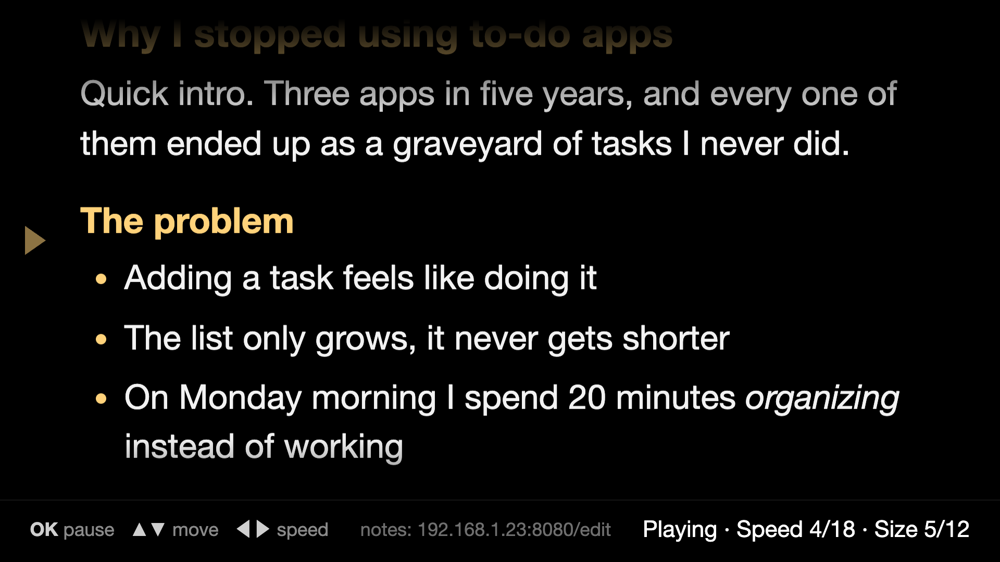

<p align="center"></p>

<h1 align="center">TV Prompter</h1>
<p align="center"><b>Your notes on the TV in front of you, scrolling as slowly as you like.</b><br>
A free teleprompter for Android TV and Google TV.</p>

<p align="center">
  <a href="https://github.com/merbil/tv-prompter/releases/latest"><b>Download the APK</b></a> ·
  <a href="https://merbil.github.io/tv-prompter/">Website</a> ·
  <a href="RELEASE_NOTES.md">Release notes</a> ·
  <a href="https://buymeacoffee.com/merbil">Buy me a coffee</a>
</p>

<p align="center">
  
</p>

## What it does

I have a TV right in front of my eyes at my desk, so I wanted to use it as a teleprompter for my notes. TV Prompter shows your notes in big white text on a black screen and scrolls them very slowly while you keep an eye on them. You don't type anything on the TV, because it shows a little address at the bottom of the screen and you paste your notes there from your phone or laptop.

- **Edit from your phone or laptop.** While the app is open, it shows its edit address at the bottom of the TV screen when you open it and whenever you press a button (something like `192.168.1.23:8080/edit`). Open that in any browser on the same Wi-Fi, paste your notes and press Save. The TV picks them up within a few seconds and starts from the top.
- **Zoom and speed** in 12 text sizes and 18 speeds (the slowest one barely moves, which is the point).
- **Move inside the text** with the arrows, while it's playing or paused.
- **It remembers** your size, speed and position, and keeps the screen awake while you read.
- **Burn-in care for OLED TVs.** The reading marker fades away when you're not pressing anything, paused text dims after 2 minutes, the TV can go to its screensaver after 10 minutes, and the whole screen drifts a few pixels every minute.

## Markdown-friendly notes

You can paste plain text or Markdown. A blank line starts a new paragraph, and single line breaks are kept as they are.

| Type | You get |
|---|---|
| `# Title` | a big yellow heading |
| `## Section` / `### Smaller` | smaller headings |
| `**bold**` | **bold** |
| `*italic*` | *italic* |
| `- item` | a bullet list |
| `1. item` | a numbered list |
| `> quote` | a quote |
| `---` | a divider line |

## Remote controls

| Button | What it does |
|---|---|
| OK | Play or pause (at the end, it starts again from the top) |
| ▲ ▼ | Move back or forward in the text |
| ◀ ▶ | Text size while paused, speed while playing |
| ⏪ ⏩ | Jump back or forward |
| 0 | Back to the top (if your remote has numbers) |
| Back | Close the app |

## Install

**You need:**
- an **Android TV or Google TV** on Android 8.0 or later (Sony, Philips, TCL, Hisense, Xiaomi, Chromecast with Google TV and so on)
- a computer or phone on the **same network** as the TV

It doesn't work on Samsung (Tizen) or LG (webOS) TVs. Fire TV can sideload APKs too, but I haven't tested it there.

**Before you start.** TV Prompter isn't on the Play Store, and the APK isn't signed by a registered developer (it's signed with my own key). That means you install it yourself, which is called sideloading. Your TV may say the app is from an unknown source, and Google Play Protect may warn you about an unknown developer. That's expected, and the whole source code is right here if you want to check what it does.

**Option 1, from a computer with adb:**
1. On the TV, open **Settings → System → About** and press OK on **Build** (or **Android TV OS build**) 7 times, until it says you're a developer.
2. Go to **Settings → System → Developer options** and turn on **USB debugging**.
3. Find the TV's IP address under **Settings → Network & Internet** (pick your network and it's listed there).
4. Download **Prompter-x.y.z.apk** from the [latest release](https://github.com/merbil/tv-prompter/releases/latest), then run:
   ```sh
   adb connect <tv-ip>
   adb install Prompter-x.y.z.apk
   ```
   Accept the **Allow USB debugging?** prompt on the TV the first time.
5. Turn USB debugging off again when you're done, so your TV isn't left open on your network.

**Option 2, without a computer:** install a sideloading app from the Play Store (such as **Downloader** or **Send Files to TV**), allow it under **Settings → Apps → Security & restrictions → Unknown sources** (the name differs per TV), then open the APK with it.

TV Prompter then shows up as a tile on your home screen.

## Build from source

You don't need Android Studio, only a JDK 17 and the Android command-line tools (on a Mac, `brew install openjdk@17 android-commandlinetools`, then `sdkmanager "platforms;android-34" "build-tools;34.0.0"`).

```sh
git clone https://github.com/merbil/tv-prompter && cd tv-prompter
scripts/build-apk.sh                 # builds Prompter.apk (signed with a debug key unless you give it your own)
scripts/install.sh <tv-ip>           # adb connect + install
```

On the TV, the app is a full-screen WebView showing `assets/prompter.html`, plus a small HTTP server in Java that serves that page and the notes editor on port 8080.


## Privacy & security

- Everything stays on your TV and your home network. There's no account, no cloud and no analytics.
- The edit page is served by the TV itself, over your home network, and only while TV Prompter is open on the TV. It's plain HTTP with no password, so anyone on the same Wi-Fi could open it while the app is running. Use it at home, not on a shared network.
- Found a security issue? See [SECURITY.md](SECURITY.md).

---

TV Prompter is an independent project, not affiliated with Google or any TV maker.
Licensed under the [MIT License](LICENSE).
